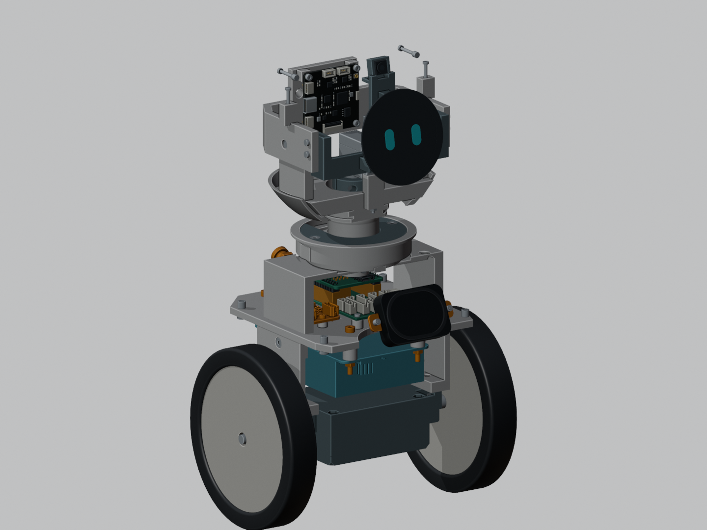

# MORI

两轮主动平衡机器人原型：两只轮驱舵机、两只头部舵机、圆形触摸屏、真实摄像头与板载音频。成品使用 **WeAct STM32F412**；树莓派验证车单独放在 `test_rig/`。

**当前项目版本：1.3.0-dev.1 · 2026-10-25 · PROTOTYPE / UNVALIDATED。** 成品 UPS、成品 IMU 和唯一自制驱动载板是当前方向；尚未完成成品整机装配、完整线束及上电验证，不是制造版本。

## 当前外观


上图来自保存的 M1.58 主模型，保留实际外壳、孔位和轮胎间隙；是 CAD 预览，非实物照片。

<details>
<summary>查看同版内部结构</summary>



主模型仍含旧 P5R7 载板与外置 6 V Buck。新 C3 板和板载 6 V 供电尚未同步进去，完整线束也未采用。

</details>

## 从这里开始

| 要找什么 | 当前入口 |
|---|---|
| 最新进度、剩余事项 | [当前状态](docs/CURRENT_STATUS.md) · [待办](docs/PREARRIVAL_BLOCKERS.md) |
| 最新完整 Blender 模型 | [mori_v1_2.blend](mechanical/mori_v1_2.blend) · [模型说明](mechanical/LATEST_MODEL.md) |
| 机械图册、打印件 | [机械](mechanical/README.md) · [静态图册](mechanical/index.html) · [STL](mechanical/exports/stl/) |
| 唯一自制驱动板 | [C3 R108P 工程、BOM 与检查](hardware/driver/README.md) |
| 模块和采购情况 | [硬件总览](hardware/README.md) · [已采购记录](mechanical/procurement/采购记录.md) |
| 固件、网页和模拟测试 | [软件](software/README.md) |
| 树莓派可行性验证车 | [独立样机项目](test_rig/README.md) |
| 目录怎么用、资料在哪里 | [目录规则](docs/PROJECT_LAYOUT.md) · [资料索引](docs/PROJECT_INDEX.md) |

## 版本与进度

| 工作包 | 当前版本 | 边界 |
|---|---|---|
| 项目资料 | **1.3.0-dev.1** | 新供电/IMU/单载板架构开发快照；未发布正式 Release |
| 完整机械模型 | **V1.2-M1.58** | UPS 直固、居中主控、上充电下开关；15 本体打印件，完整带线装配未闭合 |
| 当前驱动板 | **C3 R108P** | 40 项未连接、27 个网络，**FAIL**；尚未替换主模型中的旧载板 |
| 机械独立板卡检查 | **C3 R86B** | 局部空间/接口检查；不是 R108P 整机适配通过 |
| 装配视频 | **M1.57-A1** | 旧参考，仍含已取消的接口板；本次按要求不重新生成 |
| 成品软件 | **1.2.0-dev.1 / F412 基线** | 禁驱启动和主机/模拟验证；尚未适配新 UPS/BMI323/C3 |

选择 1.3 开发版是因为系统架构已改变；机械、PCB 和固件保留真实修订号，不能把资料整理写成它们全部同步完成。原始 [V1.2 规格](MORI_SPEC_V1_2.md)保留为需求来源，后续已确认变更见 [当前需求](docs/REQUIREMENTS.md)和 [更新记录](docs/CHANGELOG.md)。V1 旧入口已移除，历史通过 Git 查看。

## 下载与本地查看

```sh
git lfs pull
python3 tools/check_project.py
python3 -m http.server 8000 --bind 127.0.0.1
```

打开 `http://127.0.0.1:8000/mechanical/index.html`。三个当前 Blender 工程使用 Git LFS；驱动板工程、证据包和视频使用普通 Git。只有需要重建 CAD 时才恢复厂家网格及历史构建输入，见[下载与重建说明](docs/GITHUB_ARCHIVE.md)。以上操作不连接设备，不刷写或驱动电机。

## 来源

保留[第三方通知](THIRD_PARTY_NOTICES.md)、[机械来源](mechanical/THIRD_PARTY_NOTICES.md)和[软件许可说明](software/THIRD_PARTY_V1_2.md)。厂家文件与图片保持原始来源；公开仓库不改变第三方权利。几何、ERC/DRC、主机或模拟检查均不等于实物资格验证。
