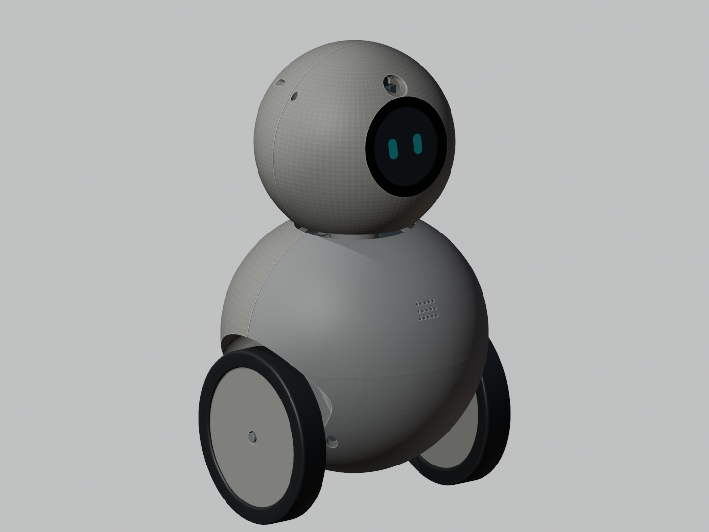

# MORI：正式机器人与可行性验证小车

本仓库包含两个独立项目。**先选择项目，再看该项目的模型、硬件、软件和验证状态。** 两者的版本及实测结果不互相继承。

| 项目 | 正式机器人 | 可行性验证小车 |
|---|---|---|
| 入口 | **[robot/](robot/README.md)** | **[test_rig/](test_rig/README.md)** |
| 目标 | 四执行器成品机器人，STM32 F412 主控 | 树莓派 4B 两轮平衡与模块验证 |
| 项目资料版本 | **1.3.0-dev.2** | **0.1.0-dev.1** |
| 当前结构 | **M1.58** | **R59 组合**：R37 底板、R41 轮圈、R55 第二层、R59 相机支架 |
| 自制电路 | **C3 R108P**，40 项未连接 | 使用成品模块，无独立自制 PCB 版本 |
| 软件实现 | **1.2.0-dev.1 / F412 基线** | **v184** 平衡与遥控源码 |
| 最新模型 | [mori.blend](robot/mechanical/mori.blend)（Git LFS） | [R59 装配 ZIP](test_rig/mechanical/assemblies/test_rig_R59_TWO_LAYER_CAMERA.blend.zip) |
| 待办与验证边界 | [正式机器人状态](robot/docs/CURRENT_STATUS.md) | [验证车状态](test_rig/STATUS.md) |

项目资料版本用于标识整理后的交付快照；M1、C3 R、v184 是各自工程修订号。正式机器人模型尚未采用 C3，软件也尚未完成成品 UPS/BMI323/C3 适配。验证车的 60 秒无人接触平衡证据属于 v141/v142；v184 新调整的实物改善仍为 NOT_TESTED。



上图是正式机器人 M1.58 的 CAD 预览。验证车照片与模型见其独立入口。

```text
MORI/
├── robot/          正式机器人：尺寸、合同、机械、PCB、固件、应用、文档与工具
├── test_rig/       验证小车：结构、模块、控制源码、关键实测记录
├── projects.json   两个项目的入口与版本清单位置
├── tools/          仓库级完整性检查
└── .github/        两项目独立检查工作流
```

- [版本与目录规则](VERSIONING.md)
- [换电脑继续工作的交接](HANDOFF.md)
- 正式机器人原始 V1.2 规格保留在 [robot/MORI_SPEC_V1_2.md](robot/MORI_SPEC_V1_2.md)，后续已确认变更见 [当前需求](robot/docs/REQUIREMENTS.md)。

Python 3.12+ 离线检查，不连接硬件：

```sh
python3 tools/check_workspace.py --allow-lfs-pointers
python3 robot/tools/check_project.py --allow-lfs-pointers
python3 test_rig/tools/check_release.py
```

查看正式机器人静态图册：在仓库根目录运行 `python3 -m http.server 8000 --bind 127.0.0.1`，打开 `http://127.0.0.1:8000/robot/mechanical/index.html`。下载或重建说明见 [robot/docs/GITHUB_ARCHIVE.md](robot/docs/GITHUB_ARCHIVE.md)。
