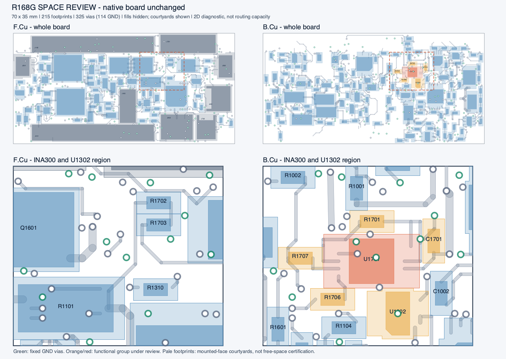

# R172：局部空间与联合布局依赖检查

本轮只读检查 **C3 R168G** 的原生几何，未构建新候选板，也未采用任何布局变化。当前开发入口仍有 **20 项未连接；20/40 = 50% 仅为剩余连接数量比例**，不是工程完成率。

## 空间结论

70 × 35 mm 板上共有 215 个封装、1398 段走线、325 个过孔，其中 114 个为必须保留的地孔。按器件所在面的原生装配包络（courtyard）求并集，正面占板面积约 **70.0%**，背面约 **40.6%**。INA300 附近 `x40–54 / y6–18 mm` 的 14 × 12 mm 窗口中有 **40 个过孔，其中 13 个地孔**。

这些结果支持当前布局的局部拥挤，**尚不能证明整板面积不足，也不能证明维持现有尺寸一定能完成布线**。包络之外的面积不等于可用布线空间：铜间距、原生禁布区、参考地、通孔尾端、对插及完整三维装配约束仍需分别检查。四个安装孔的圆形 courtyard 未被本次包络提取器计入；安装孔和原生规则没有因此豁免。

该图已实际查看，显示原生器件包络、走线和过孔，省略填铜；不是全板逐线审查或机械配合结论。

## 两项有界筛查

严格位置／朝向筛查以 0.25 mm 网格，在中心 `x44–51 / y9.5–16 mm` 比较 0°、90°、180°、270°。预先释放 U1701、R1701、C1701、R1706、R1707、33 段指定局部线及三处指定非地供电换层位置，其余约束保留。筛查仅剩两个位置，均无所检查的直线 FAULT 出口；这不是全局无解证明。

扩大的依赖筛查列出 292 个乐观位置候选，把额外器件、非地过孔及保留铜冲突明确列为待重排依赖，没有将冲突豁免。其中原朝向 `(46.75,14)` 与 90° `(48.75,12.25)` 均涉及 **U1302** 和 `(47.775,14.1)` 的原 3.3 V 过孔；这些是上述五器件／33 段线／三换层位置之外的依赖，不能说成总共只需移动一只 IC 和一个孔。

筛查未完成无源器件摆放、去耦／供电恢复、RLIMIT 至实际 U1701.8 的显式直接回地及完整布线。首次依赖脚本的语法失败和修正后结果均保留，失败源码按原字节保存为文本。

## 下一步与确认边界

从 R168G 比较包含 U1302 及其相关外围的联合布局，先安排完整输入、LIMIT、直接回地和去耦回路，再布 FAULT 主干。保留全部 114 地孔、固定接口和原生规则；任何非地孔或原线变化均须明确列出并完整恢复原功能，随后重做原生及电气回归。

用户要求空间不足时及时告知。一旦具体检查表明现有尺寸或固定接口成为阻碍，应说明冲突位置、受影响规则及所需空间；涉及扩大板框或改变已确认结构时，先准备具体模型和静态对比供确认。本轮没有扩大板框，也没有形成需要批准的尺寸提案。

19 份载荷按文件哈希及解压后字节核验，采用板和 77 个非 PCB 原生成员不变。物理、热、耦合及整板资格仍未完成，不可制造。

[汇总](summary.json) · [空间数据](raw/R172-space-review/report.json) · [严格筛查](raw/R172-ina-pose-screen.json) · [依赖筛查压缩结果](raw/R172-ina-dependency-screen.json.gz) · [归档清单](archive_manifest.json) · [字节核验](archive_verification.json)
