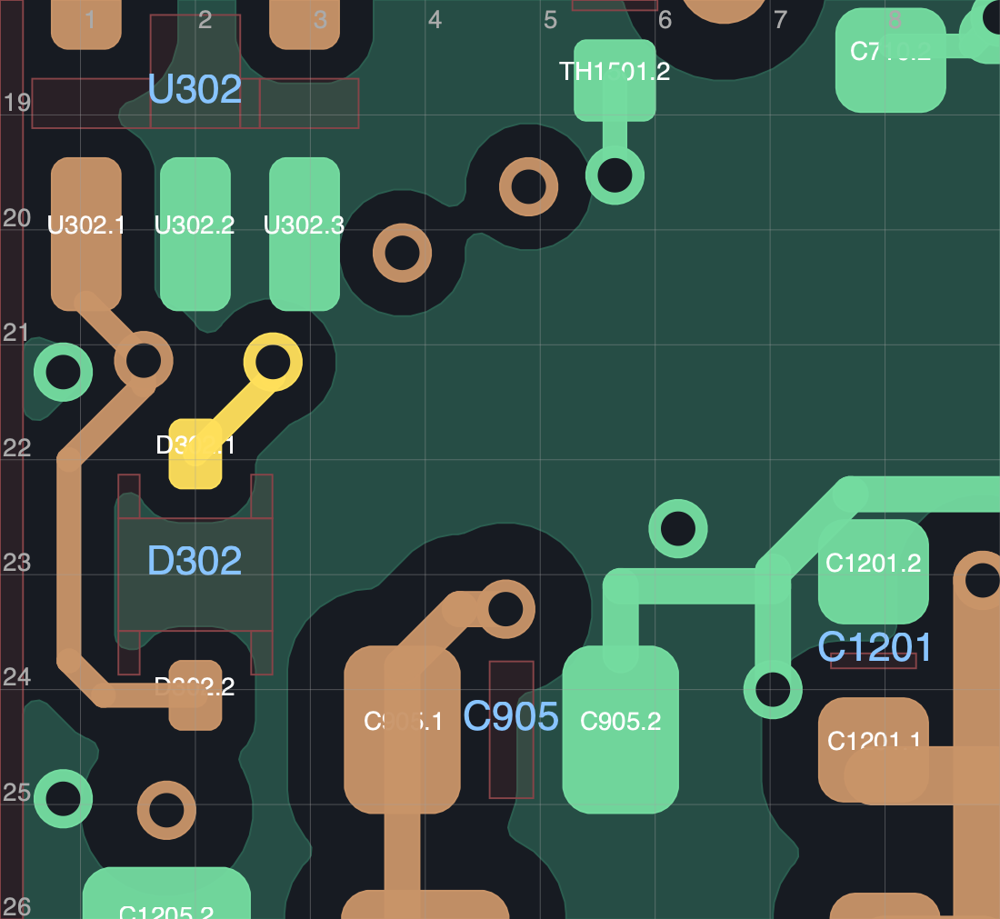

# C3 R178L：D302 FAULT 支路接通

2026-10-29，仅采用到独立开发入口。正式发布仍为 C3 R108P，机械和软件未采用本稿；整板仍为 FAIL / PROTOTYPE / UNVALIDATED，不可制造。

D302 保留 BAT54WS-7-F / SOD-323、原焊盘 UUID、极性及电气映射，从背面 `(25.75,7.5)` / 0° 调整为正面 `(2,23)` / 270°。FAULT 从上端接到原过孔 `(2.675,21.15)`，CLR 从下端沿器件左侧接到原过孔 `(1.55,21.1375)`。两条 0.20 mm 新线分别长 **1.079594155 / 4.106002884 mm**；七段新线替换五段旧 CLR 引线，没有新增孔。

- 原生重填铜：**19 未连接 / 0 其他 DRC / 0 图板差异 / 0 启用 ERC**。19/40 = 47.5% 只是剩余未连接数量比例。
- **2515 项明确差异检查通过**；原连接、50 项铜宽、155 地焊盘单组、63 项邻接和新旧参考地保持。历史六项换参考层提示仍未关闭。
- 114 个原地孔、全部其他原过孔和 77 个非 PCB 工程成员保持；板框、安装孔、核心针位与固定连接器不变。当前 1400 段 / 325 孔 / 215 器件。
- 九张局部原生几何图已实际查看。没有新同面本体穿越；新 FAULT 对 DVDT 铜和 L701/L901 本体投影均为 0。CLR 的背面 C1207 / HEAD_VM 投影有内层地覆盖，仍不代表噪声、热、故障动态或实物装配资格。

原始几何回归的 FAIL 保留，用于标记显式申明的翻面、位置和旧线替换；不能用它掩盖电气失败。[精确计划核对](planned-delta.json)与[原生结果](result.json)分别通过本轮所列门槛。翻面工具仅额外支持这一个指定 D302 定义，未泛化到任意二极管或接口；13 项保存读回及拒绝用例见[研究记录](../R178_study/README.md)。

[修改计划](plan.json) · [原生 DRC](drc.json) · [ERC](erc.json) · [铜与连接回归](regression.json) · [INA300 显式回地](ina300-return.json) · [局部审查](visual_review.json) · [投影与参考地](local_reference_review.json) · [尺寸与线长记录](metrics.json) · [接收与成员哈希](adoption.json) · [剩余连接](remaining_connections.csv)

剩余 FAULT 孤立端仅 U1701.5；完整布线、全板审查、厂家布局、额定/热/浪涌/EMC、线束及真实装配等仍须继续。数字检查没有关闭完整接口板任务。
