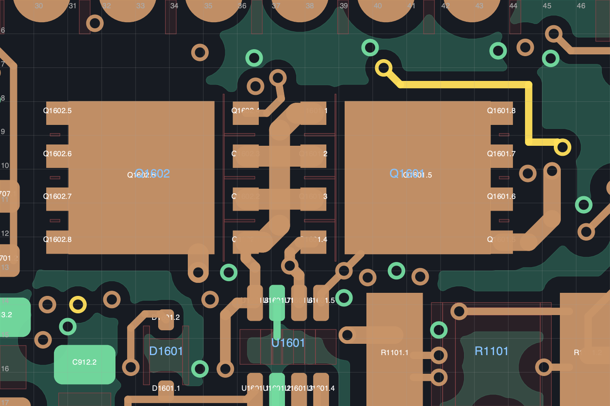
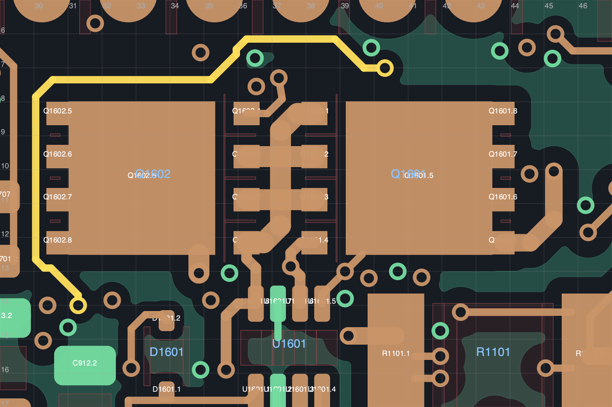
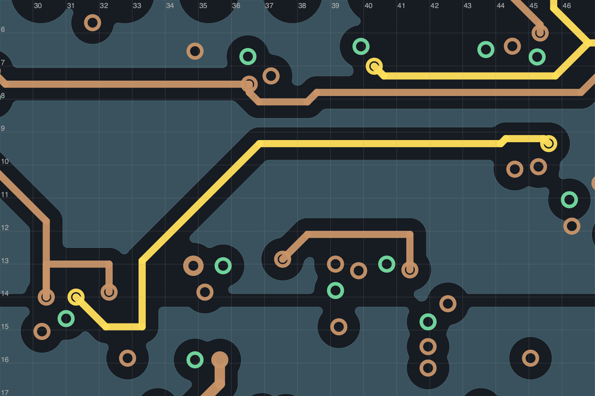
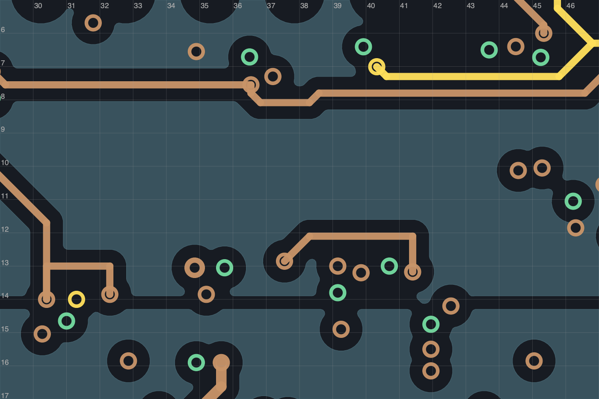

# R181C：采样支路换路，仅接收本地开发几何

从 R179I `0314affe1179898dbb679292c8c4ecb8f59838d5753302436854bf4ea5e76af9` 接收为 R181C `13f4f91514c85d54c8802c1cb061967ee915272a3d1ad34daac18e419bb47d66`。当前仍 **19 项未连接**，本轮没有减少未连接数；相对原 40 项的 47.5% 只是数量比例。正式发布仍为 R108P，机械和软件未采用本版，不能制造。

## 实际改变与保留

`Net-(U1001-S2_{slash}_WHEEL_sense)` 原八段 In3 线和五段 F 线改为十三段 F 线，支路中心线总长 25.512702 → 18.203088 mm。复用 `(31.3,14)` 和 `(40.3214,7.0064)` 两处换层孔；退休 `(45.6,9.35)` 处已经没有其他接触层的一个非地孔。全部原焊盘连接保留。原 R179I 记录的 CLR / In3 采样线交叉随对应采样段退休而消失；原始交叉检查证据保留，不重写为新板验证。

当前 1409 段 / 324 孔 / 215 器件。324 个保留原孔的属性逐项不变，其中 114 个原地孔全保留。无新孔、器件移动、电路或网络变更；70 × 35 × 1.6 mm 六层板、四安装孔、68 核心针位、九连接器、原生规则和禁布区不变。77 个非 PCB 原生成员逐字节保持。[接收记录](adoption.json)含哈希与完整源备份位置；[计划](plan.json)保留构建前“未采用”状态，后续采用仅以接收记录为准。

## 检查与边界

| 检查 | 实际结果 |
|---|---|
| KiCad 10.0.7 原生填铜 DRC / 未连接 / 图板一致性 / 启用 ERC | 0 / **19** / 0 / 0 |
| 精确计划差异 | **PASS，2523 项**；原始严格几何审计 FAIL 对应明确列出的替换/退休，未豁免额外差异 |
| 原焊盘连接 / 供电铜宽 / 地连通 / 关键邻接 | 保持 / 50 项 PASS / 155 地焊盘单组 / 63 项 PASS |
| 新旧参考地 | 无新增缺口、无原线参考地损失 |
| 回流提示 | 仍有六项历史提示；两处复用孔的局部回地筛查 PASS，未新增提示 |
| 器件所在面本体 | 新线无名义 Fab 本体相交；未将对侧投影作为全层禁布区 |
| 局部图审 | 六层实际原生几何图及两张源板对照图已查看，限定局部几何 PASS |
| 完整厂家布局、噪声/瞬态/热、整板逐线审查及实物资格 | **NOT_TESTED**；整板工程状态仍为 FAIL |

完整结果在 [result.json](result.json)、[planned-delta.json](planned-delta.json)、[regression.json](regression.json)、[geometry_review.json](geometry_review.json)、[visual_review.json](visual_review.json) 和 [剩余连接表](remaining_connections.csv)。自动检查不代替全板审查或实物资格。

## 局部空间与采样风险

新 F 线在 Q1602 左侧和上侧通过，距其漏极焊盘的最小名义铜边间距为 **0.2225 mm**；距 C707.1 为 **0.375 mm**。背面的 U1001 / R303 本体及所列内部/外层异网投影有 In1 地覆盖。两处复用孔的最近地孔距离约 0.716 / 0.721 mm。这些是原生 CAD 的几何值，不是测量值、加工公差、串扰或热裕量。

[TMUX1511 厂家资料](https://www.ti.com/lit/gpn/TMUX1511) SCDS390B 第 10.1–10.2 节支持短输入线、连续地和减少不必要换层的布局方向；其中高速示例不能直接证明本板采样性能。邻近 Q1601/Q1602 属于 [LM74502](https://www.ti.com/lit/ds/symlink/lm74502.pdf) 高侧/反接保护电路，并非 Buck 的一对开关管；其原功率铜、栅极引线及关键邻接未改变。完整采样准确度、瞬态耦合和热影响仍待资格审查。

G 曾尝试增大与 MOSFET 的间距，但与 CAM 电源走线/焊盘短接。H 曾合并两处小折线，DRC 为零却新增两处参考地缺口。C 因此保留原来的局部偏移，不把更直的外观当作电气改进；完整板级布线风格审查仍未结束。见[八稿比较](../R181_study/README.md)。

| 源 R179I | 接收 R181C |
|---|---|
|  |  |
|  |  |

图片是原生几何诊断渲染，不是实物照片或 KiCad GUI 截图；坐标单位 mm。新通道没有解决 U301 与 3.3 V 供电的联合布线问题，下一步见[继续开发](../../NEXT.md)。
