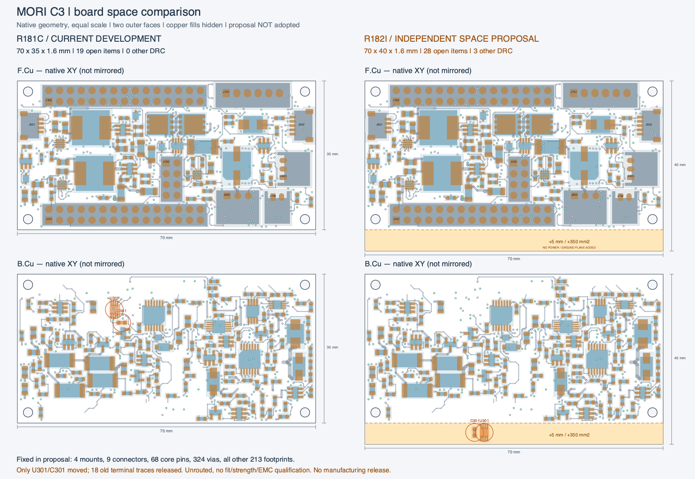

# R182：局部通道冲突与独立板框比较

**没有采用本轮试验。当前入口仍为 R181C，19 项未连接。** 原生源哈希为 `13f4f91514c85d54c8802c1cb061967ee915272a3d1ad34daac18e419bb47d66`。原 40 项中的剩余数量比例为 47.5%，不是工程或时间完成率。正式发布仍为 R108P；未制造、未上电。

本轮先依据实际 R181C 重算供电规划保护，保留全部 50 项源检查及往返核对。没有把 R179I 的旧结果改标签继承。A–G 的原生布线试验均未同时保住原连接；H 仅用于释放 U301/C301 原末端后的访问筛查，不是可用设计。

| 原生试验 | 未连接 / 其他 DRC | 供电检查 | 主要未解决项 |
|---|---:|---:|---|
| A | 20 / 0 | 47/50 | CLR 未恢复；3.3 V 分成 39/17 焊盘两组 |
| B | 21 / 2 | 47/50 | 释放 U1401 OUT 内层走线，供电与旧信号仍断 |
| C | 20 / 2 | 49/50 | 0.30 mm 供电桥仍未保住源 0.30 mm 检查 |
| D | 20 / 2 | 50/50 | 0.35 mm 桥恢复供电，但 OUT 和 CLR 未恢复 |
| E | 20 / 1 | 48/50 | OUT 绕行切断 CAM_BAT_OUT；J702 热焊盘连接不足 |
| F | 20 / 4 | 48/50 | 上移 OUT 碰到 ACT_CURRENT_ADC / GND，并新增参考地缺口 |
| G | 20 / 1 | 47/50 | 避开 CAM 狭颈后又切断 3.3 V |
| H：筛查准备 | 26 / 3 | 49/50 | 原末端明确释放，不能作为改进稿 |

全部 A–H 的图板差异为 0，155 个地焊盘仍为一个连接组；这些局部通过项不能抵消表中的失败。本轮未重跑启用 ERC；源 R181C 的既有结果不能冒充每个试验的新结果。原生 DRC、回归与源绑定哈希见 [汇总](summary.json)。

## 空间结论与限制

当前局部拓扑确实拥挤：U301 的信号出口、原有 3.3 V / CAM 供电路径、固定过孔、同面本体和参考地共同限制通道。E 中 CLR 的限定可达区只在 B.Cu，约 `x19.95–21.9 / y12.85–15.0`，没有找到合法新孔位；右侧 `(22.5,14.7)` 是 **UPS_5V** 过孔。

扩大 U301/C301 搜索范围后，背面 51 个有限网格姿态均未找到四个信号的完整独立访问。正面初筛的 25 个姿态漏算了 NPTH 孔，后续按原生孔重新检查，23 个被排除；剩余 `(6.5,21)` 的 0°/180° 姿态也没有完整信号及供电访问。不得把初筛 25 个位置写为可用安装位置。

这是保留其他功能组、有限位置网格和单网可达性模型下的结果；C301 最终布局、同时布线及实际装配仍需验证。**它不证明 70×35 mm 全局不可布通，也不证明必须扩板。** 后续应比较更大范围的功能组重排，或在机械允许时研究额外板面积，不再反复尝试相同 U301 局部拓扑。

## R182I：70×40 mm 独立空间候选，未采用

- 原板 `70×35×1.6 mm`；候选仅沿 PCB 原生 +Y 把边从 35 延至 40 mm，面积增加 350 mm²，约 14.3%。这不是布线能力增加率；机器人安装方向尚未映射。
- 四安装孔、九接口、J101/J102/J105 共 68 核心针位、全部 324 过孔（含 114 原地孔）和另外 213 个器件保持原位。原下排孔心距新边由 2.5 增为 7.5 mm，新增悬伸段的支撑与强度未验证。
- 只把 U301/C301 移到新增区域并明确释放 18 段旧末端线。没有扩展电源和参考地铜皮，没有完成接线。原生结果 **28 未连接 / 3 其他 DRC / 0 图板差异**，电气验收 FAIL；不是解决全部剩余连接的方案。
- 已展示静态图及独立原生模型，询问是否允许研究扩大板框；截至记录时未收到方向回复。**未采用、未做机械适配、未获结构采用授权。** 当前开发入口仍保持原尺寸。

[准确尺寸与固定接口检查](raw/R182I-space-check.json) · [三条板边的明确修改](raw/R182I-outline-edit.json) · [候选原生板压缩副本](raw/R182I/MORI_Interface_C3.kicad_pcb.gz) · [矢量对比图压缩副本](raw/R182-space-comparison/comparison.svg.gz)

原生可编辑完整工程仍保留在本地忽略目录 `robot/.state/c3-completion/trials/R182I/`。归档原生板可与 `source_commit` 指定的工程成员按哈希恢复；不得直接导出制造文件。

## 证据与继续工作

[归档清单](archive_manifest.json)保存源板、九块独立原生板、计划、命令、搜索结果、供电保护、渲染和辅助脚本；[归档校验](archive_verification.json)核对每份原字节及 gzip 往返。[更正说明](corrections.json)保留 NPTH 初筛漏项、U1401 OUT 端点名称、KiCad 保存归一化、首次渲染错误及核心针数统计修正，未改写原失败记录。实际查看的三张图见[视觉记录](visual_review.json)。

等待尺寸方向期间仍可处理其他未连接网络及原尺寸下更大功能组的重排。所有原连接、规则、禁布区、供电与参考地要求保持。整板逐层审查、厂家完整布局、六项历史换参考层提示、接口/BOM/线束、机械装配及实物资格仍在完整任务范围内；目标未完成。
