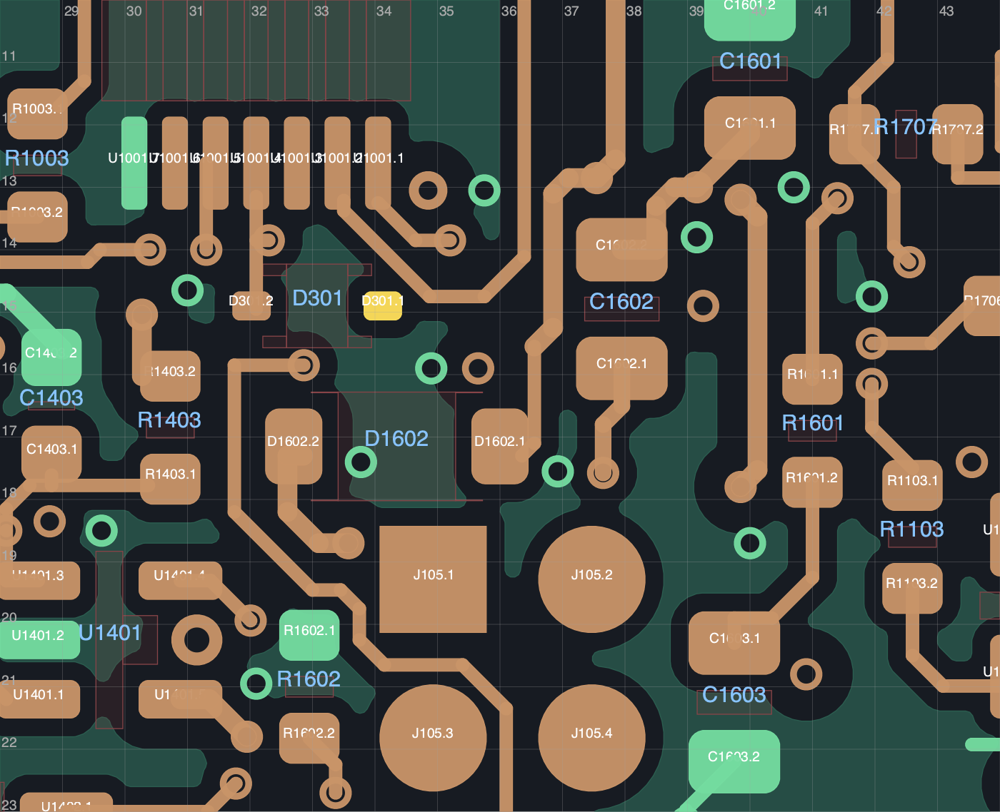

# R183：复位支路与钳位／充电泵的空间依赖

**没有采用本轮试验；当前入口仍为 R181C，19 项未连接。** 源板 SHA-256 为 `13f4f91514c85d54c8802c1cb061967ee915272a3d1ad34daac18e419bb47d66`。正式发布仍是 R108P，未制造、未上电。19/40 = 47.5% 仅为剩余连接数量比例，不是工程或时间进度。

## 固定布局与原生试验

根据原生 DRC 的端点 UUID，本轮筛查剩余 17 对连接、16 个网络；U301.3 和 U1701.5 的固定出口已有前序研究，未重复微调。这 17 对均未找到网格路线。另一次仅去掉额外供电规划保护的诊断也没有找到路线；原生规则、禁布区、参考地、实际铜物体及采用验收要求保持不变。诊断未写入任何 PCB，也不是降低供电要求。

| 原生试验 | D301 位置与朝向 | 未连接 / 其他 DRC / 图板差异 | 未采用原因 |
|---|---|---:|---|
| A | 背面 `(29,30.25)`，270° | 20 / 6 / 0 | 两处排针 PTH 铜进入庭院，四处丝印压铜；原 CLR 连接未恢复 |
| B | 背面 `(42,26)`，0° | 20 / 0 / 0 | 普通 DRC 干净，但原 CLR 连接未恢复，不能接收 |

两块试验均保住 50/50 源供电检查、155 个地焊盘单组、63 项邻接和新旧参考地检查；全部原地孔保留。**这些通过项不能抵消丢失的 CLR 连接。** 本轮未重跑启用 ERC，不能套用源板结果。两块板、精确计划、原生命令、DRC 与回归记录均归档。

最初的局部位置筛查只核对孔与本体，漏掉了 PTH 铜进入庭院。A 的原生失败揭示该漏项；修正后，六个初选姿态只剩原位置的两个朝向。原始结果和失败板保留，没有把初筛位置改写为可用布局。

## 成组比较结果

扩大到两面和整板范围，得到 246 个背面、42 个正面几何姿态。按每个姿态恢复真实焊盘、本体和过孔保护后，未找到 NRST 与 CLR 均可访问的姿态。这是有限网格、逐网访问筛查，尚未包含同时布线，不证明全局不可布通。

B 的 NRST 可规划一条约 25.4033 mm 的背面绕边路线，但 CLR 仍未恢复；该路线**没有构建进 PCB**。CLR 的近侧通道同时受 D1602、C1602、ACT_GATE、VCAP、供电铜和固定过孔限制。

进一步释放 D301、D1602 的明确末端与两个非地换层孔，保留全部地孔和其他器件，按 0.125 mm 网格、八个朝向比较：D1602 只剩原位置及偏移约 0.0354 mm 的位置。加入 C1602 及其明确末端／VCAP 非地孔后，独立筛查得到 68 个 D1602 姿态和 407 个 C1602 姿态；恢复 D301 与旧 CLR 支路并核对两器件相互避让后，剩下 192 对组合，其中 D1602 最大位移仍只有 0.0354 mm。不能将两个独立可放位置直接拼成可用布局。

上述筛查保持 D1602 至 U1601 的 5 mm、C1602 至 U1601 的 3 mm 项目邻接限制。它们是项目几何门槛，不是完整厂家布局资格。预先释放的末端与非地孔只用于规划，未修改当前板，也未建立恢复后的完整电路。

## 后续与证据边界

下一轮应把钳位、充电泵、门极斜率 RC、真实换层孔及复位出口一起比较，并同时恢复所有原连接、供电和参考地。R1601 是门极斜率 RC 的串联电阻，不能当作对地下拉独立挪动。不要重复相同的固定邻居布局，或以一条 NRST 提案替代完整设计。

本轮证实局部空间与布线路径受到共同限制，**尚不能断言 70×35 mm 全板空间不足，也不能保证加宽 5 mm 足够**。[R182 的 70×40 mm 独立候选](../R182_study/README.md)仍等待尺寸研究方向回复，未采用；当前板框、固定接口和机械主模型保持不变。

[汇总](summary.json) · [归档清单](archive_manifest.json) · [218 份载荷核验](archive_verification.json) · [三张实际查看的局部图](visual_review.json)

所有原始本地文件仍保留。归档核对源板、77 个非 PCB 工程成员、载荷哈希与 gzip 往返；两份生成但未执行的辅助脚本在汇总中明确列出。整板逐层审查、厂家完整布局、六项历史回流提示、BOM／线束／机械与实物资格仍未完成；当前板不可制造，目标未完成。
