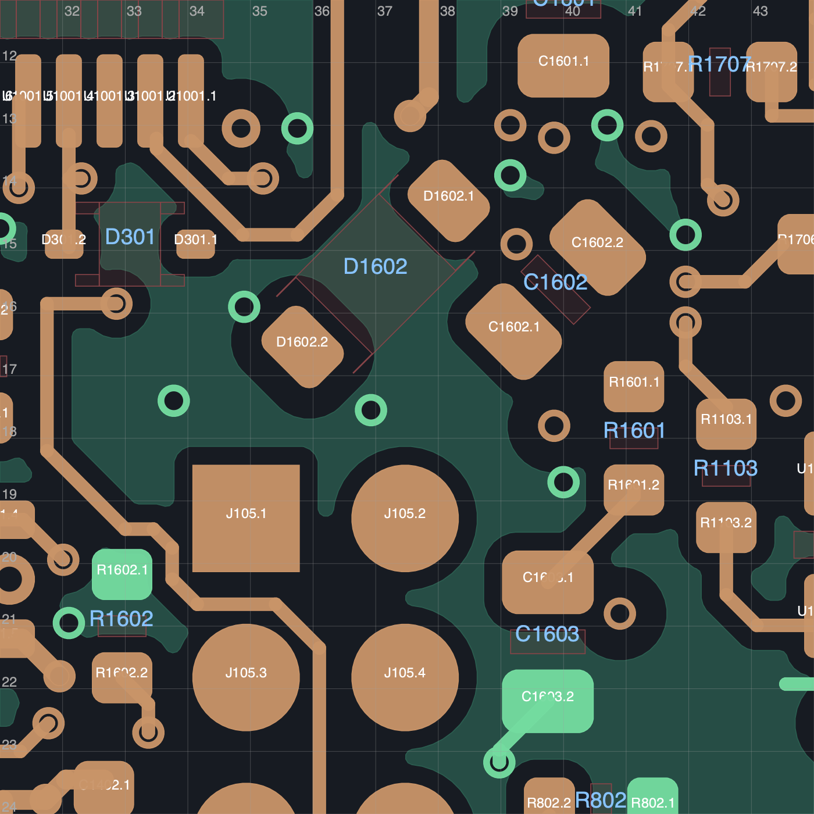

# R184：整组摆放与 UPS 5 V 供电通道必须一起解决

**没有采用本轮试稿。当前入口仍是 R181C，19 项未连接，70×35 mm 板框不变。** 正式发布仍为 R108P；工程未制造、未上电。以下均为独立规划或失败试稿，不能用几何可放、普通 DRC 较少或归档通过代替完整电气验收。

## 空间比较

本轮把 D301、D1602、C1602、R1601、C1603 及明确末端一起纳入比较。保持原 UPS 5 V 供电桥时，独立几何筛查分别得到 D1602/C1602/R1601/C1603 的 70/407/1574/557 个姿态；相互避让后，钳位与充电泵的 192 对组合仍只能使 D1602 最大移动 0.0354 mm。释放门极 RC 并未单独解决这个限制。

原背面供电桥经过 `x40.12, y13.47–17.53`，属于 **UPS_5V**，不是门极或电流采样线。独立规划中再明确释放该桥的三段 0.30 mm 线后，四个器件的姿态数变为 201/650/2352/889。保留原 D301/CLR、固定 C1603 及其原回地，比较得到 25 个有限几何组合后停止；这不是完整可布线组合数。仅用 90° 整数倍朝向的限定比较没有找到对应完整组合，也不证明其他网格或布局不可能。

这项差异说明：**器件位置与供电通道共同占用局部空间，不能只看还有多少空白面积。** 释放供电桥只是规划假设；所有原供电宽度与连接必须恢复才能采用。R182 的 [70×40 mm 独立候选](../R182_study/README.md)仍待尺寸研究方向回复，未采用；本轮没有扩大板框或变更固定接口。

## R184D 原生试稿，未通过采用验收

- D1602：背面 `(37,15.375)`，225°；C1602：背面 `(39.875,15.625)`，45°；R1601：背面 `(41.125,18)`，270°。D301、C1603 和 C1603 原有直接回地保持。
- 明确删除 36 段末端线及 3 个非地过孔，接回两段 RC 支路。原 114 个地过孔全部保留；没有把初筛省略的铜当成已经恢复。
- 原生重填铜结果为 **26 项未连接、3 项悬空过孔、0 图板差异**；本轮启用 ERC 未重跑。供电检查只通过 **46/50**，UPS_5V 与 UPS_BAT 原连接失败；GATE、SOURCE、VCAP 也有原连接丢失。
- 155 个地焊盘仍为单组，63 项邻接通过，新旧走线参考地没有新增缺口；这些局部通过项不抵消断路。完整计划差异验收没有执行，试稿未接收。

七个实际网络访问筛查只找到一条 0.80 mm 的 D1602 门极接入提案，尚未写入 PCB；NRST、5 V 桥、SOURCE、VCAP、电容供电及 RC 门极端均未找到当前模型下的完整路线。不能把这条短提案计为完成一个电路或减少当前 19 项。

## 工具失败与保护检查

A 因混合禁布规则的重建限制而在保存前被拒绝；B 因移位后焊盘成为待退休过孔的唯一接触层、与计划声明不符而被拒绝，两者保留的是源板副本。C 曾尝试把 SOURCE 孔移到 `(35,14.5)`，该点碰到 `Net-(D1001-K)`；保存读回的网络检查拒绝了它。**C 不可沿用，该孔位不能再作为可用位置。** 原错误和文件均保留。

D 使用仅供本轮的显式分组重建辅助脚本，保留 D1602 全部九个规则区的 UUID、限制标志及原过孔开口坐标，按 KiCad 纳米坐标量化预期几何，没有放宽面积误差阈值。重填铜后的九区读回与 114 地孔核对通过；删除禁孔标志、挪动单个禁布区的两个内存反例均被拒绝。生产构建器和完整计划验收器未修改，不能把此专项结果写成通用工具升级或试稿合格。

[构建与规划更正](corrections.json) · [混合规则专项检查](raw/R184D-mixed-guard-readback.json) · [原生与搜索汇总](summary.json)

## 后续工作与资格边界

下一步必须先恢复和保留实际换层路径，再比较完整布线：保留未移动 C1601 到 `(39.15,13)` 的两段原 UPS_BAT 接入；优先检验保留原 VCAP 换层孔及正面引线；钳位新位置必须给 SOURCE 的实际换层孔留出空间，或先证明替代孔位在所有层、供电与参考地下可用。5 V 桥与门极 RC 应同时规划，不要继续接收只有摆放结果的组合。

本轮重新读取 TI 的 [LM74502 数据手册](https://www.ti.com/lit/ds/symlink/lm74502.pdf)第 19 页布局要求：输入旁路靠近 VS，门极／源极连接要短，充电泵电容应避开 MOSFET 热影响。[原文件与来源记录](raw/R184-vendor/source.json)已保存。项目 3/5 mm 邻接限制不是厂家给出的数值合格线；温升、耦合、保护动态和实物效果仍未验证。

本轮只实际查看两张局部原生几何图；RC 新线与正面 R805 的少量投影仍需完整热／耦合审查。整板逐层审查、六项历史回流提示、BOM、线束、机械装配和实物资格尚未完成。局部空间拥挤已经有证据，但仍不证明原尺寸全局不可布通，也不证明增加 5 mm 足够。

[归档清单](archive_manifest.json) · [原字节与压缩往返核验](archive_verification.json) · [实际查看的图](visual_review.json)。所有本地原稿保留；当前 R181C 及 77 个非 PCB 源成员未变。
