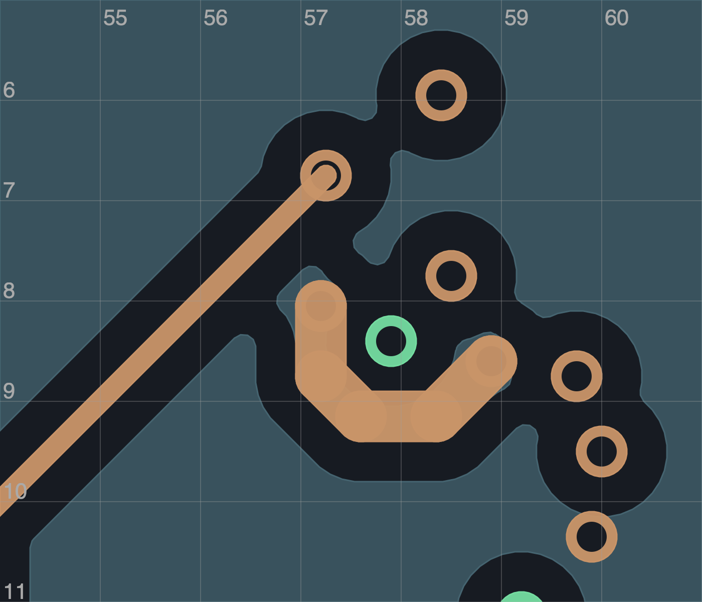

# R185：地孔与供电联合调整，独立候选仍未采用

**开发入口仍为 R181C：19 项未连接、6 项历史换层回流提示，70×35 mm 板框不变。** 本轮保留十块原生试稿，没有接收 PCB 修改。I 的完整数字检查通过，但局部耦合审查尚未关闭；不能把它的 5 项提示写成当前入口已改善。正式发布仍 R108P，不能制造。

## 约束来源更正

核对实际对话及项目规则后，确认“所有原地过孔位置冻结”是早期工具的保守限制，并非用户要求或原生设计规则。[来源记录](raw/R185-constraint-provenance.json)保留实际指令。明确计划可以研究地孔移动，仍须保住原生禁布区、供电、直接回地、参考地和全部原连接。

新增 `move_ground_vias` 操作，要求精确源哈希、UUID、网络、孔型和各层铜环快照，完整原接触线清单及对应回地替换。当前支持的直接回地不得变长或变窄，固定焊盘及原地孔身份保持，实际重填铜后检查两参考面接触。原 `move_vias` 仍只处理非地孔，未放宽原生规则。[21 项正反例](raw/R185-ground-move-controls-v2.json)及[旧 R181C 计划重放](raw/R185-previous-R181C-replay.json)通过；工具通过不等于试稿采用。

收尾复核修正了参考地检查：旧逻辑把过孔自身铜环包含在“地平面”中，可能把孤立地孔误算为已接地；现在只核对实际 In1／In4 地区填铜。R181C 和 I 的 114 个地孔均有两层实际接触，126 个合格地锚点、原换层距离及 6／5 项提示均未变化。[五项实际填铜正反例](raw/fill_contact_followup/R185-filled-ground-controls.json)通过，I 的[2508 项检查重跑](raw/fill_contact_followup/R185I-planned-delta-v2.json)通过。旧几何报告的 `actual_plane_contacts` 是包含自身铜环的代理值，原文件保留；[补充记录](raw/fill_contact_followup/R185-filled-ground-review.json)给出正确方法与 I 两层各约 0.159427 mm² 的名义接触面积，不能据此推导阻抗或实物性能。

## 独立候选 I

- 原 C601 地孔从 `(57.55,7.75)` 移到 `(57.9,8.4)`，保留 UUID、网络、孔径和各层铜环。C601 回地从两段共 1.719975 mm 改为一段 0.925 mm 直线，宽度仍 0.20 mm。
- 为恢复被移孔切开的 3.3 V，增加 2.793503 mm、宽 0.50 mm 的 In2 供电桥及 `(57.2,8.05)` 新电源孔。原 114 地孔身份全保留，另 323 个原孔属性不变；器件、板框、安装孔和接口未移动。
- **19 未连接 / 0 其他 DRC / 0 图板差异 / 0 启用 ERC**；[2508 项精确差异检查](raw/R185I-planned-delta.json)通过。全部原连接、50 供电铜宽、155 地焊盘单组、63 邻接与新旧参考地保持，历史换层提示在此独立候选中为 5 项。

**I 暂不采用：** 新供电桥投影到正面 UPS_BAT／TVS 铜，其中约 **0.0134372 mm²** 没有中间 In1 地覆盖。它与 In3 HEAD_OE 的投影约 **0.1031798 mm²**，In2 和 In3 之间没有地层，不能称为隔地屏蔽。这些是名义 CAD 投影，不是实测串扰或已证实故障；瞬态耦合影响尚需设计审查。[几何记录](raw/R185I-geometry-review.json)保留逐项数据。

TI 的 [TCA9517 数据手册](https://www.ti.com/lit/ds/symlink/tca9517.pdf)第 11–12 节要求约 100 nF 去耦靠近供电脚；[SN74LVC2G32](https://www.ti.com/lit/ds/symlink/sn74lvc2g32.pdf)第 10 节也强调近端旁路。本轮未移动这些芯片或去耦器件，缩短回地不代表完整电源／逻辑抗扰度合格。[原文件与哈希](raw/R185-vendor/source.json)已保存。

## 失败对照及空间结论

A/B 的加孔或移孔切断 3.3 V，仅通过 45/50 供电检查。C 的短桥恢复焊盘连通，却损失较宽供电通道、削弱 HEAD_VM、增加换层提示且未对中过孔。D/F 有旧参考地缺口；E 违反 D1801 禁孔区；G 只剩 0.15 mm 走线／过孔间距，均拒绝。H 组合满足数字要求，I 用正式明确计划重建并完成全面数字核对。

J 向外绕行后消除了未屏蔽的 TVS 投影，却出现 **0.00105835 mm²** 新线参考地缺口，与 In3 HEAD_OE 的投影增至 **0.3010551 mm²**，未采用。固定两端、0.50 mm 线宽、无新孔、局部 6×5 mm 窗口内的 0.025 mm 网格搜索未找到同时满足这些条件的路线；去掉额外供电规划保护的诊断也未找到。有限搜索不是全局不可布通的证明。

复位／钳位研究保留实际 SOURCE、VCAP 换层及 C1601 供电后，得到 574 对钳位／电容几何组合，仍无钳位明显移位的完整组合。下一步须纳入控制器与实际出线口，不能重复省略供电或换层孔的摆放结果。

局部通道拥挤已告知用户。下一轮从 **R181C** 联合调整 C601 供电／回地与相邻 HEAD_OE、DISARMED 出口；I 只作独立比较。旧填铜完整覆盖拟移地孔铜环只是保守规划代理，验收依据是重填后的实际连接，原生限制不变。[R182 的 70×40 mm 候选](../R182_study/README.md)仍未获尺寸研究方向回复、未采用，不能推断加宽 5 mm 就足够。

[十稿结果](summary.json) · [更正记录](corrections.json) · [九张实际图审](visual_review.json) · [218 份归档载荷](archive_manifest.json) · [原字节核验](archive_verification.json)。补充实际填铜检查时，最初 203 份载荷保持原字节。原 R181C、77 个非 PCB 成员及全部本地原稿保留。全板、完整厂家布局、热／瞬态、实物资格和工程目标均未完成。
