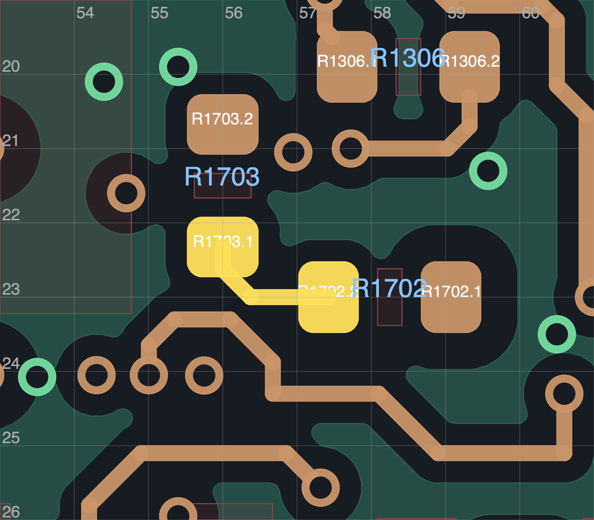

# R186：UPS 出口、分压组换位及全板参考地复查

**没有采用本轮 PCB 修改。当前仍为 R181C / 19 项未连接 / 6 项历史换层提示，70×35 mm 板框、安装孔和接口不变。** 四块原生试稿均保留，正式发布仍 R108P，不可制造。

## 空间结论

UPS／比较器附近的局部通道确实拥挤。元件能放下、两只元件之间能连线，并不代表完整信号、供电和回地可以同时恢复。单独移孔失败；把 R1702/R1703 分压组与 R1102/C1102 滤波组换位后，仍需处理完整端点与邻近供电通道。

当前证据没有证明 70×35 mm 全局不可布通，也没有证明加宽 5 mm 足够。[R182 的 70×40 mm 独立比较](../R182_study/README.md)仍未获尺寸研究方向回复、未采用；没有修改机械主模型。

## 原生候选与拒绝原因

| 候选 | 未连接 / 其他 DRC / 图板差异 | 实际结果 |
|---|---|---|
| A | 19 / 21 / 0 | 联合移动 D1801、C1002 地孔和采样出口。内层短接／间距、禁孔区及新旧参考地均有失败，拒绝 |
| B | 23 / 2 / 0 | 四器件换位准备稿；局部支路有微小反折，三个原网络尚未恢复，未采用 |
| C | 22 / 2 / 0 | 改善局部转折，保留 R1704–U1702 的固定分支；仍有三组原连接待恢复及两项悬空，未采用 |
| D | 23 / 3 / 0 | 接回轮电源取样与电流放大器输出，却切断 CAM_BAT_OUT／3.3 V 并割裂 GND，拒绝 |

这四稿没有重跑 ERC，不能写作“启用 ERC 通过”。完整逐项数据在 [summary.json](summary.json)，原始原生 DRC、脚本、计划和填铜后 PCB 均在归档中。

A 的 C1002 回地虽然缩短，但移孔与已有 In3 信号相交；长度改善不能抵消短路。其 5 项旧参考地损失、3 项新线缺口也未通过。原生禁布区和线宽／间距没有放宽。

四器件几何筛查得到 524 组分压对、7064 组滤波对；排除小于 0.30 mm 的独立转折段和反向折返后分别剩 86 / 1698 组。这是本轮比较用的路径形态筛选，不是新增制造规则，也不是全部组合已布通。B/C 均只有局部支路连接。

C 的 155 个地焊盘保持单组、新旧参考地检查未新增缺口，供电通过 49/50；缺少的是移位后的 WHEEL_VM 取样连接。保留原供电规划保护的三次端点搜索均无路线。去掉该额外保护做诊断后，轮电源和电流输出出现路线，比较器输入仍无路线；诊断不豁免最终供电要求。

D 把两条诊断路线真正写入原生模型并重填铜，供电仅通过 **43/50**：CAM_BAT_OUT 两项、MOTION_3V3 五项失败，地焊盘分成 **153 + 2**。它没有新增已检查走线的参考地缺口，但这不足以接受断电／孤立地网。不能将“搜到路线”计为完成。

## 新发现的全板参考地待审项

过去的新旧差异检查要求本轮不增加缺口，并不代表所有继承走线原本都有完整参考地。本轮对当前源板 **1296 段非 GND 走线**做完整覆盖扫描，按既有焊盘及同网换层豁免，标出 **81 段、38 个网络**需要逐项审查。[扫描](raw/R186-full-reference-survey.json)与既有审核算法的 [1296 段交叉核对](raw/R186-reference-survey-control.json)一致。

这些是继承的几何待审项，**不是 81 个原生 DRC 违规，也不是 81 个已证实电气故障**。开关节点、模拟输入、控制线与电源应按用途检查，不能一律豁免或一律判坏。[待审清单](raw/R186-reference-review-queue.json)保留全部 UUID 与范围。较大的项目包括 IMU_SCL、U1702 输入、HEAD_6V_RAW 和 CAM_REG_3V87；阻挡 UPS 出口的原 U1702 输入长线也在其中。

TI 的 [TPS3700 数据手册](https://www.ti.com/lit/ds/symlink/tps3700.pdf)第 18–19 页讨论分压输入精度、噪声与近端 0.1 µF 旁路；它没有给本轮分压电阻位置设毫米距离上限。缩短并重排该输入是工程提案，不是直接满足某条厂家尺寸规定。[SLVA680A](https://www.ti.com/lit/an/slva680a/slva680a.pdf)的短保护路径建议只是一般 ESD 布局参考，不构成所选 SMBJ 电源浪涌电路验证。[原资料与哈希](raw/R186-vendor/source.json)已保留。

## 工具修正与继续入口

实际 C1002 地线从焊盘内部偏离中心的位置起线。`ground_via_moves.py` 现在允许明确声明这一原始出口，要求出口位于真实焊盘铜内且与原轨迹首段一致，并把中心至出口长度计入原回路。原中心出口默认行为、原孔 UUID／网络／孔型、回地不变长／不变窄及全部原生验收保留。[六项正反例](raw/R186-ground-exit-controls.json)通过，不代表 A 可采用。

还更正了端点删除范围：原 R1703 路径遍历包含 R1704 与 U1702 共用的固定分支，C 已保留该分支。成对几何计算通过等价的分项距离／交集加速；原先只完成第一组的计算及日志保留，没有把中止算作无解。初始局部查询对过孔调用无层参数 `GetWidth()` 的警告已记录，相关宽度不能作为正式孔型证据。

下一步从 **R181C** 出发，在选定摆放位置前检查每个外部端点的实际出线能力。若继续四件换位，必须同时恢复 CAM_BAT_OUT、3.3 V、GND 通道，并纳入 R1704/U1702 输入及相邻控制出线，不能重复本轮固定位置搜索。全板参考地待审项另按电路逐项关闭。

[十张实际图审记录](visual_review.json) · [归档清单](archive_manifest.json) · [原字节核验](archive_verification.json)。原 R181C、77 个非 PCB 成员和本地实验原稿保留。全板布线、完整厂家布局、热／瞬态与实物资格仍未完成。
