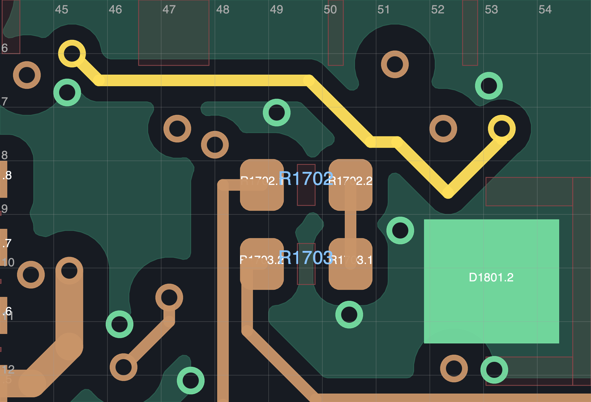

# R187F 局部参考地修复接收记录

R187F 只接收到独立开发工作区：**19 项未连接，0 其他 DRC / 0 图板差异 / 0 启用 ERC**。没有新增完成的未连接项，19/40 = 47.5% 只是剩余数量比例。正式发布仍 R108P；机械、软件未采用，不能制造。

原生 PCB SHA-256：`6dbcf638a4292c080a05c01f46f9317d69bd655f37d57f0da46d6e3d3bfcb876`。源 R181C 的 [PCB 压缩副本](source_R181C.kicad_pcb.gz)、全部源成员和六块试稿均保留。

修改只包含 12 段旧线换成 18 段新线及两只已有非地过孔的明确移动：采样钳位孔 `(47.3,7.075)` → `(47.3,7.4)`，3.3 V 孔 `(52.25,7.65)` → `(52.25,7.4)`。同步重排 IMU 时钟、轮通信尾段及这两个孔的原接入线。没有器件移动、新孔、电路／元件值／规则／禁布区／板框变更。当前 1415 段 / 324 孔 / 215 器件，114 原地孔及 77 个非 PCB 成员保持。

[2529 项计划核对](planned-delta.json)、全部旧连接、50 供电铜宽、155 地焊盘单组、63 关键邻接、INA300 直接回地及新旧参考地回归通过。严格几何回归中的 FAIL 是明确退休的线段及移孔差异，不能单独当作电气失败，也不能省略计划核对。[实际原生命令与结果](commands.json)保留 KiCad 10.0.7 的输出和项目默认值规范化记录；原项目字节已恢复。

[完整参考地扫描](reference-survey.json)检查 1302 段非 GND 线，待审项从 81 段／38 网降至 **76 段／37 网**。IMU_SCL 四处及 WHEEL_TX 的一处 In2 缺口已消除，没有新标记或恶化的保留段。WHEEL_TX 的原 B 面缺口仍在。[比较](reference-comparison.json)与[当前队列](reference-review-queue.json)均保留具体 UUID。这是名义几何检查，未证明 76 项都是电气故障，也不是完整 EMC 合格。

四张源板与六张最终局部层图已实际查看，见 [视觉记录](visual_review.json)和[几何记录](geometry_review.json)。最终 IMU 尾段从下方进入原过孔，新增 0.20 mm 中心引线在原孔铜环内；轮通信的 0.10 mm 中心引线也在原孔内。同面本体检查通过。3.3 V 支路线宽维持 0.20/0.50 mm，修改部分总中心线长度保持 6.057843 mm；IMU 修改段增加 0.20 mm，WHEEL_TX 增加约 0.389949 mm。

新增 In2 WHEEL_TX 对 In3 MOTION_3V3 电源面的投影约 0.171461 mm²，**两者之间没有地层**。连续 In1 GND 距 In2 的名义介质厚度为 0.13 mm，In2 至 In3 为 0.9328 mm；U402 接收端由该 3.3 V 供电。结合完整参考和供电回归，这一处接受为继续开发的布局判断，不能表述为屏蔽、零耦合或实际层叠已确认。新增对背面 R1001 的本体投影有 In4 地覆盖。详细边界见[耦合审查](coupling-review.json)。参考 [TI SCAA082A](https://www.ti.com/lit/an/scaa082a/scaa082a.pdf) 的连续参考与功能组耦合原则，不据通用指南宣称本板资格通过。

19 未连接、六项历史换层提示、76 项参考地待审、厂家完整布局、瞬态／噪声／热、真实层叠及实物资格继续开放。[剩余连接](remaining_connections.csv) · [本轮对照](../R187_study/README.md) · [继续开发](../../NEXT.md)
