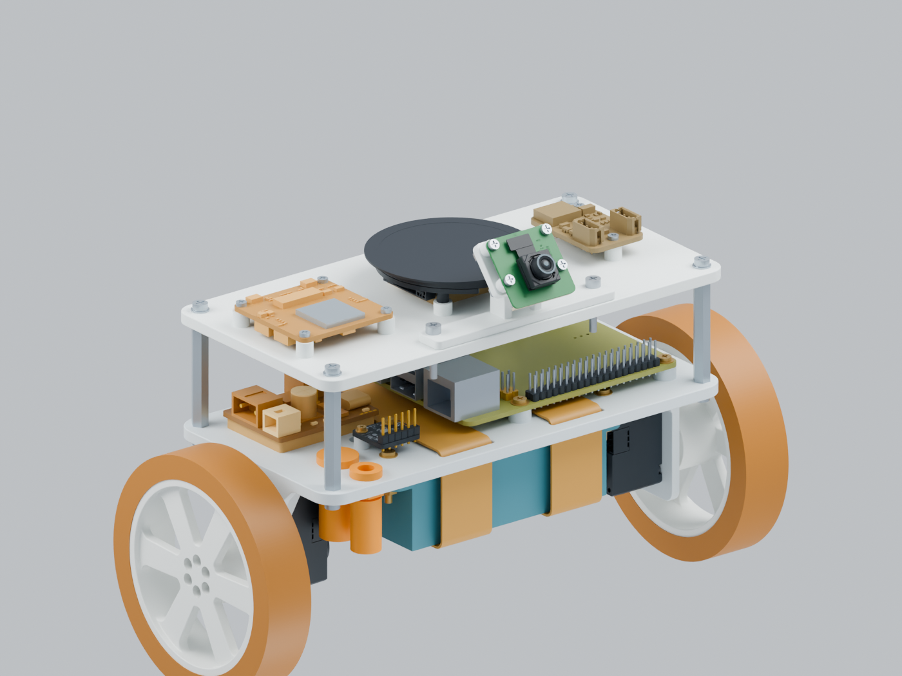

# 两轮平衡可行性验证车

这是 MORI 的独立验证装置：树莓派 4B、BMI323、宇树 USB 单总线板、两只 S288 和车载 3S UPS；第二层承载 CAM 板、圆屏、喇叭和 6 V Buck。它与主项目 M1 系列结构、PCB 和固件分别维护。

**项目资料版本 0.1.0-dev.1 · 2026-10-25；结构 R59 组合；控制源码 v184。** 这是验证车首次独立编号的资料快照，版本真源见 [project.json](project.json)。已保存一次属于 v141/v142 的 60 秒无人接触平衡证据；v184 新调整的实物效果尚未验证。最新本地记录停在第 128 轮结束、v184 已部署但第 129 轮未启动；本次只做离线整理，没有重新查询或驱动设备。详细边界见[验证状态](STATUS.md)。



| 要找什么 | 入口 |
|---|---|
| 底板、轮圈、第二层和摄像头支架 | [模型与打印文件](mechanical/README.md) |
| 每个孔用什么螺丝、怎样装配 | [装配与紧固件](ASSEMBLY.md) |
| 模块清单、资料来源 | [硬件清单](hardware/README.md) · [厂家原件索引](hardware/specifications/source_manifest.json) |
| 供电和通信连接 | [当前接线说明](hardware/WIRING.md) |
| 平衡源码及不接硬件的检查 | [控制快照](control/README.md) |
| 已做到了什么、还差什么 | [状态和证据](STATUS.md) · [证据边界](evidence/README.md) |
| 下载完整性、来源和保留范围 | [交付说明](DELIVERY.md) · [导入清单](import_manifest.json) |

当前设计组合为 **R37 一体底板 + R41 轮圈 + R55 第二层 + R59 前视 40° 摄像头支架**。R60 是后视、增高 5 mm 的对比方案，未替换 R59；第三层和头部双舵机不在这次两层交付中。照片估算的模块细节、名义螺丝包络和几何检查不能替代实物尺寸核对。

下载后可直接查看 STEP/STL；Blender 装配在普通 ZIP 内，不需要额外下载本目录的 LFS 对象。用 Python 3.12 或更新版本在仓库根目录做离线核对：

```sh
python3 test_rig/tools/check_release.py
cd test_rig/control
python3 -m unittest discover -s tests -q
```

控制测试使用模拟串口/IMU 和 C++ 数值对照，需要 `c++` 编译器，不打开真实设备。生产运行还需要本机标定、适配的 CAM 固件和现场明确启用；没有默认开机启动或自动故障重启。
