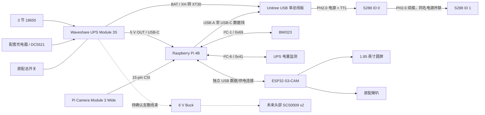

# 供电与通信

这是截至 2026-10-18 的验证车连接说明。供电拓扑沿用模块方案；实际连接器极性须按丝印和原厂手册检查。图中的虚线支路是后续扩展，不代表已经连接或上电。

| 信号 | Pi 4B J8 **物理脚号** | 说明 |
|---|---:|---|
| BMI323 3V3 / GND | 1 / 6 | 传感器供电 |
| BMI323 SDA / SCL | 3 / 5 | GPIO2 / GPIO3，I²C-1，实测地址 0x69 |
| UPS SDA / SCL | 15 / 16 | GPIO22 / GPIO23，独立 I²C-6，实测地址 0x41 |
| UPS 监测 GND | 14 | 与 Pi 共地 |

UPS 监测后续实际采用独立 I²C-6，区别于旧 R5 图的可选共总线规划。原记录设置为 `dtoverlay=i2c6,pins_22_23`；这只是既有配置记录，本次没有远程修改。UPS J1 应选择 3.3 V 上拉参考，不能把两块板的 3V3 输出并联；记录中的成功通信不是电平实测。

S288 使用 6 Mbps / 8N1，由 USB 单总线板完成半双工收发，Pi GPIO 不直接并接舵机信号线。两电机续接是通信总线和电源同名网络并联，不是串联供电。物理左右与 ID/正反号取决于实际装配和当次标定，不凭模型或出厂 ID 猜测。

UPS 的 **5 V / 5 A** 和 **BAT / XH 2 A** 是不同支路资料，不能把 5 A 挪用于舵机支路。S288 支持 6.4–12.6 V，该设计不额外串入 6 V Buck；没有据此推断宇树板内置了指定 Buck。3S 满电、回灌、动态峰值、插头线规和温升仍需分项验证。纯电池供电曾完成有限双轮/平衡测试，不等于全部电源边界合格。

当前控制停止使用 mode 0 和反馈确认；故障不自动重新使能。USB 失联、UPS 开关、独立执行器断电及充电状态的完整联锁仍不能视为已经硬件认证。**不边充电边进行自由平衡**；受支持/插电检查时轮子必须禁能。

[原 R5 两页框图 PDF](history/MORI_TestRig_R5_System_R1.pdf)和[连接表](history/connections.csv)仅作历史来源，包含“ID 未写入、UPS 共总线、开关待定”等已变化内容，不是当前逐线施工图。新增 CAM 支路与显示/音频连接仍须按各模块原装线束使用，完整带插头三维线束尚未冻结。
